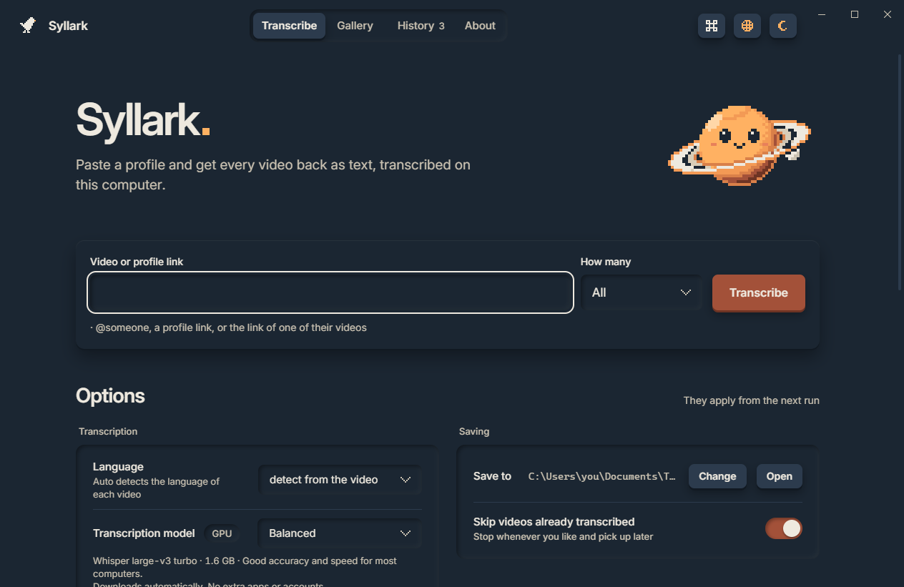

<p align="center"></p>

<h1 align="center">Syllark.</h1>
<p align="center">Public clips. Clear text. On your computer.</p>

[](https://github.com/nas2077/syllark/actions/workflows/checks.yml) [](https://github.com/nas2077/syllark/actions/workflows/codeql.yml) [](LICENSE)

Syllark turns public TikTok videos and profiles into readable transcripts. Recognition runs locally with integrated Qwen and Whisper models. Paste a link, choose an output folder, and start.

## Features

- Transcribe one video, selected gallery items, or a complete public profile.
- Readable paragraphs in Markdown or plain text, with optional timestamps.
- A per-video file, combined collection, and CSV metadata index.
- Resume previous work and retry individual videos.
- Preview covers and save original videos as MP4.
- Four integrated model choices with automatic downloads.
- Fourteen interface languages, dark/light themes, and reduced motion.

<picture>
  <source media="(prefers-color-scheme: light)" srcset=".github/assets/screenshot-light.png">
  
</picture>

## Download

The published [v0.1.0 Windows download](https://github.com/nas2077/syllark/releases/download/v0.1.0/Syllark-0.1.0-windows-x64.zip) remains available. Extract the complete ZIP and open **Syllark.exe**, keeping `runtime` beside it.

Cross-platform candidates are produced by [Checks](https://github.com/nas2077/syllark/actions/workflows/checks.yml). Download the artifact for your system from a successful run of this source revision, or build from source below. Artifacts last 14 days and require GitHub sign-in. New downloads will appear in [Releases](https://github.com/nas2077/syllark/releases) after release validation; the older Windows release does not include these changes.

| Platform | Architecture | Package / renderer |
|---|---|---|
| Windows 11 | x64 | `.zip`, WebView2 |
| macOS 15 and newer | Apple Silicon and Intel | `.app` in `.tar.gz`, system WebKit |
| Ubuntu 24.04/26.04, Debian 13, Fedora 44 | x64; Linux ARM64 build also provided | `.tar.gz`, bundled Qt WebEngine |

Recent Mint, Pop!_OS, Arch and openSUSE with glibc 2.39+ are compatibility targets; Ubuntu/Debian/Fedora have automated package checks. See [platform setup and limits](docs/PLATFORMS.md). Windows ARM can use x64 emulation; a native Windows ARM package is not provided.

Packages include Python and recognition engines. Models download on first use. Windows builds are unsigned; macOS uses ad-hoc signing without notarization. SHA-256 files accompany candidate packages. See [installation and verification](docs/RELEASING.md).

## Use

1. Paste `@someone`, a public profile/video URL, or a TikTok share link.
2. Choose the output folder and model in Options.
3. Press **Transcribe**, or use the Gallery for individual items.

The selected model downloads on first use. Natural needs about **2.3 GB** including language detection. Later jobs reuse the cache. No external model manager or transcription account is required. Opening the app alone does not download a model.

Previously transcribed videos are skipped by default. Turn off **Skip already transcribed** or redo an individual Gallery item to replace its saved transcript.

## Models

| Choice | Engine | Download |
|---|---|---:|
| Natural | Qwen3-ASR 1.7B Q8_0 | 2.3 GB |
| Balanced | Whisper large-v3-turbo | 1.6 GB |
| Thorough | Whisper large-v3 | 3.1 GB |
| Lightweight | Whisper small | 0.5 GB |

Natural is the default, using Metal on compatible Macs, Vulkan where available on Windows/Linux, and CPU fallback. Whisper uses CPU everywhere, with optional NVIDIA CUDA on Windows/Linux. Automatic CUDA library downloads are Windows-only; Linux uses separately installed CUDA 12/cuDNN 9. Recognition can make mistakes. **Natural timestamps mark audio block starts, not individual words.** [Model details and limits](docs/MODELS.md).

## Privacy

Syllark uses public TikTok access without sign-in, browser-session reads, or imported account cookies. Audio is not uploaded to a transcription service. Network access is used for TikTok content, model/library downloads, and the interface font. [Full privacy and storage details](docs/PRIVACY.md).

## Development

Use Python 3.12. Windows:

```powershell
python dev/setup.py
dev\.venv\Scripts\python.exe src\app.py
```

macOS/Linux (install [platform prerequisites](docs/PLATFORMS.md) first):

```sh
python3.12 dev/setup.py
dev/.venv/bin/python src/app.py
```

Build on the target OS with `python3.12 dev/build.py` (`python dev/build.py` on Windows). See [contributing](CONTRIBUTING.md), [architecture](docs/ARCHITECTURE.md), and [validation](docs/VALIDATION.md).

## Repository and releases

This repository contains source, documentation, tests, and artwork. Environments, model caches, downloaded media, build intermediates, and executables are excluded. Native desktop packages belong in Releases; model weights are downloaded from their upstream hosts. A small source checkout does not mean the installed models are small.

Project documentation and code use English. The app remains localized in 14 languages; translation values and multilingual fixtures retain their own languages.

## License

Original code and artwork: [MIT](LICENSE). Bundled and downloaded components have their own licenses; see [third-party notices](THIRD_PARTY_NOTICES.md) and `src/licenses`. Use content you have permission to download and transcribe.

<p align="center"><a href="https://github.com/nas2077"></a><br>Made by Nas.</p>
